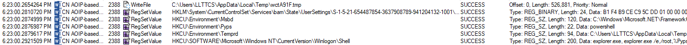

# Lab 2: Analysing wwlib.dll

**Module 1: Initial loader** · [All labs](../README.md) · Previous: [Lab 1](lab01-find-malicious.md) · Next: [Lab 3](lab03-buildtask.md)

## Goal

Work out what `wwlib.dll` does: which files it drops, where it stores them and how it persists. This is the longest lab. Pick one of two routes, or do both.

## Tools

- Route A (fast): Procmon
- Route B (deep): Ghidra and an LLM

## You need

- From Lab 1: the ISO contents, with `wwlib.dll` identified as malicious

## Route A: Procmon

1. Take a snapshot.
2. Copy the ISO contents into a working folder.
3. Start Procmon.
4. Run the `.docx.exe` and wait a few seconds, then stop the capture.
5. Set filters:
   - **Process Name** is the `.docx.exe` file name, plus any child processes it starts (use **Tools > Process Tree** afterwards)
   - **Operation** is `CreateFile`, `WriteFile` or `RegSetValue`
   - Also look at process events
6. Read the file writes and registry changes. Note every path.
7. Check the files on disk and the persistence you found, then revert the snapshot.

## Route B: Ghidra and an LLM

1. Import `wwlib.dll` into Ghidra and run auto-analysis.
2. Start from interesting imports, work your way back using cross-references, and find the two main functions that do the work.
3. Give each function's pseudo-C to an LLM, one at a time, using the prompt pattern from the deck:

   ```text
   Context: what the function is for
   Input:   pseudo-C from Ghidra
   Ask:     explain it; list every file path, registry key and API call it uses
   Verify:  I will check the paths against the strings and the files on disk
   ```

4. Check each answer: look the paths and keys up in the strings and confirm them.

## Questions

- [ ] Which files are dropped, and where?
- [ ] How does the malware persist?
- [ ] What is the BuildTask (MSBuild project) file called?

Extra questions for the reverse engineers:
- [ ] What do the two main functions do?
- [ ] What happens to the hidden `.doc` from the ISO?

## Hints

<details>
<summary>Hint for reversing</summary>

Look at function FUN_1800034e0 and check which functions it calls.

</details>

## Solution

<details>
<summary>Show solution</summary>

After running procmon and filtering for the correct events such as file creations, we can see the following activity:



### Which files are dropped, and where?

The file C:\Users\...\AppData\Local\Temp\wctA91F.tmp is dropped.

### How does the malware persist?

Persistence is achieved with the registry key HKCU\SOFTWARE\Microsoft\Windows NT\CurrentVersion\Winlogon\Shell which is set to "explorer.exe, explorer.exe /e,/root,%Pyps% -nop -w h "Start-Process -N -F $env:Msbd -A $env:Temprd""

Furthermore, the registry values Pyps, Msbd, and Temprd are set to "powershell", "C:\Windows\Microsoft.NET\Framework64\v4.0.30319\MSBuild.exe", and "C:\Users\...\AppData\Local\Temp\wctA91F.tmp" respectively.

### What is the BuildTask (MSBuild project) file called?

It is called wctA91F.tmp

</details>

## Carry into the next lab

- The BuildTask file name: it is the password for the BuildTask archive in Lab 3
- The drop paths and the persistence mechanism
