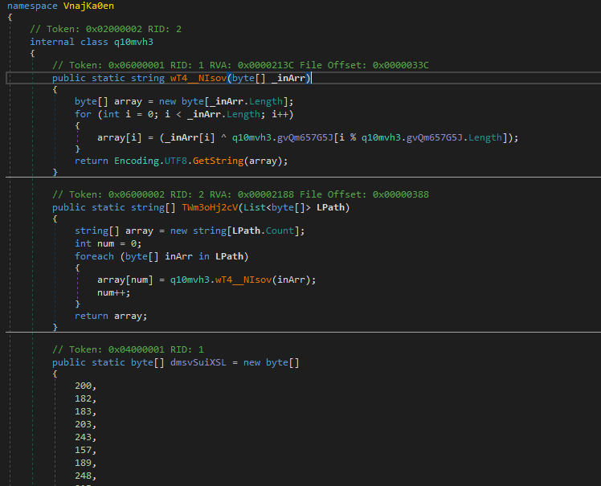

# Lab 4: The infostealer

**Module 2: KamiKakaBot** · [All labs](../README.md) · Previous: [Lab 3](../module1/lab03-buildtask.md) · Next: [Lab 5](lab05-backdoor.md)

## Goal

Analyse the infostealer payload you rebuilt in Lab 3 and find out which browsers it targets.

## Tools

- dnSpy

## You need

- From Lab 3: the infostealer payload

## Steps

1. Open the first payload in dnSpy, its name should be htu190f8i4r3kd3.
2. Find the browser targeting functionality in function JegrywbXVS and analyse which browsers are targeted.

## Questions

- [ ] Which browsers does it target?

## Hints

Hint 1

The class q10mvh3 is the one that interests us. Throw it into an LLM to XOR decode the strings.

## Solution

Show solution

### Which browsers does it target?

The function we are interested in base64 decoded a couple of strings:

The strings decode to:

- JUFQUERBVEElezB9: %APPDATA%{0}
- JUxPQ0FMQVBQREFUQSV7MH0=: %LOCALAPPDATA%{0}

Both decoded strings are part of the path to the targeted browsers, so we need to know what gets appended. The function q10mvh3.wT4__NIsov is the one that retrieves the targeted browsers and the result is appended to the appdata string. All three encoded strings are set at the bottom of the class:

We can write a very short Python script or ask an LLM to write it for us to decode the strings and we get three browsers:

The script I used is in the scripts folder.

