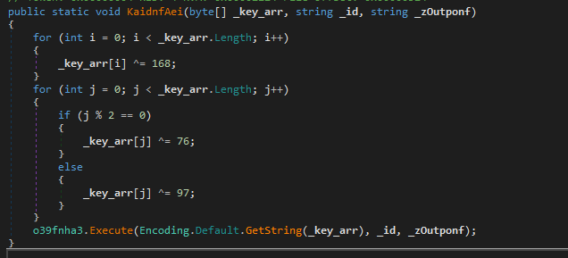
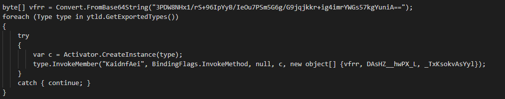
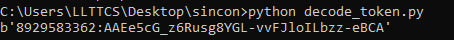

# Lab 5: The backdoor

**Module 2: KamiKakaBot** · [All labs](../README.md) · Previous: [Lab 4](lab04-infostealer.md) · Next: [Lab 6](../module3/lab06-hunt-bot.md)

## Goal

Analyse the main backdoor you rebuilt in Lab 3 and recover its Telegram bot token and the chat ID it reports to.

## Tools

- dnSpy

## You need

- From Lab 3: the backdoor payload

## Steps

1. Open the backdoor in dnSpy.
2. Look exactly at how the Build task set up the assembly, which function it called, and which arguments it used
3. Look at the first function that is called and understand the decoding algorithm
4. Try to reverse the algorithm by writing a short script with the help of an LLM or by yourself.

## Questions

- [ ] What is the bot token?
- [ ] Which chat ID does it report to?

## Hints

Hint 1

The function that is called is KaidnfAei

Hint 2

KaidnfAei first argument is a byte array created from base64 decoding 3PDW8NHx1/rS+96IpYyB/IeOu7PSm5G6g/G9jqjkkr+ig4imrYWGs57kgYuniA== while its second argument is the byte array {54,57,54,49,49,49,52,54,55,52}.

## Solution

Show solution

### What is the bot token?

KaidnfAei is the method that is called by the Build task we previously analysed:

The function does two rounds of XOR decoding on the first argument. This algorithm can be reimplemented in Python with the help of an LLM.

The argument to the decoding algorithm is specified in the build task:

It's just the string "3PDW8NHx1/rS+96IpYyB/IeOu7PSm5G6g/G9jqjkkr+ig4imrYWGs57kgYuniA==" base64 decoded.

If we provide that to our decoding algorithm, we get the bot token back:

The script I used is [decode_token.py](scripts/decode_token.py).

### Which chat ID does it report to?

The chat ID is simply the second argument to the KaidnfAei function. This second argument is the byte array {54,57,54,49,49,49,52,54,55,52}. If we ASCII decode these values, we get the chat_id 6961114674

## Carry into the next lab

- The bot token and chat ID: the BuildTask was edited by the trainer, so both are live and you hunt with them in Labs 6 and 7
